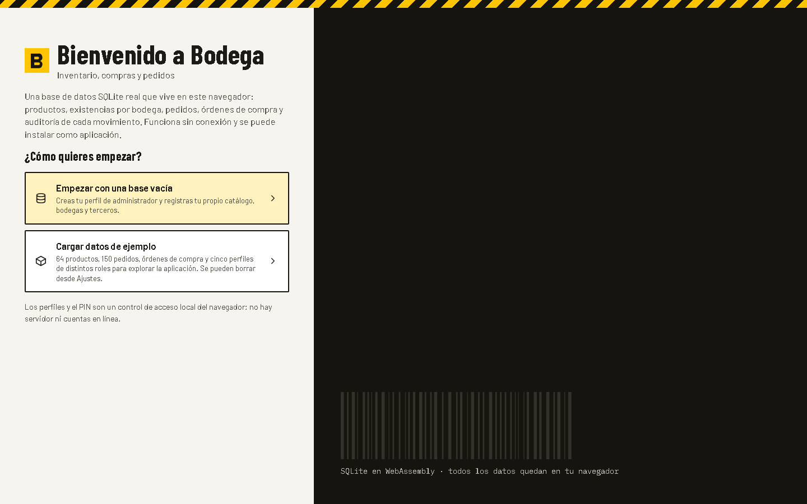
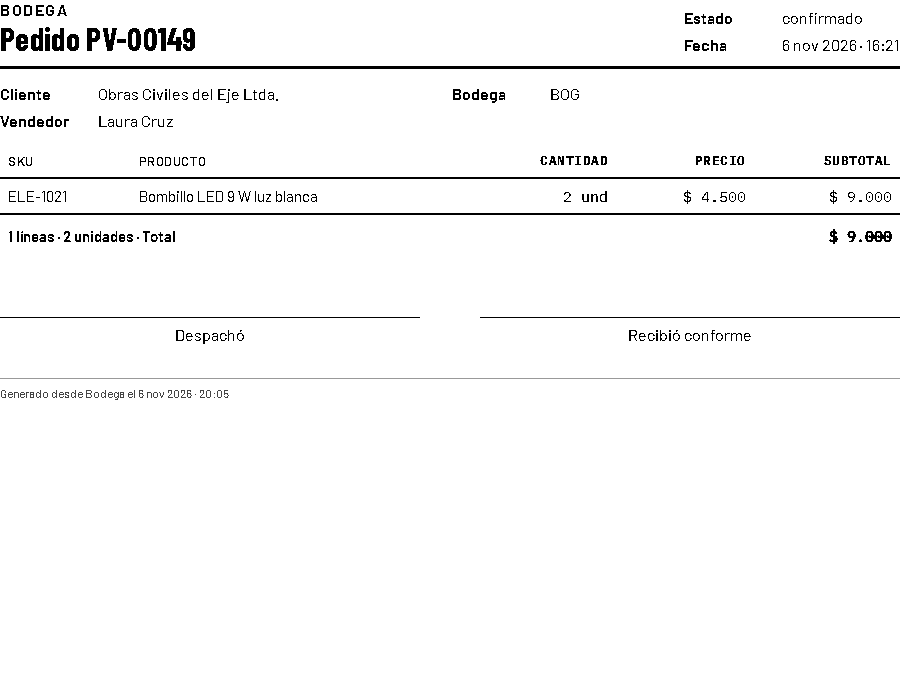
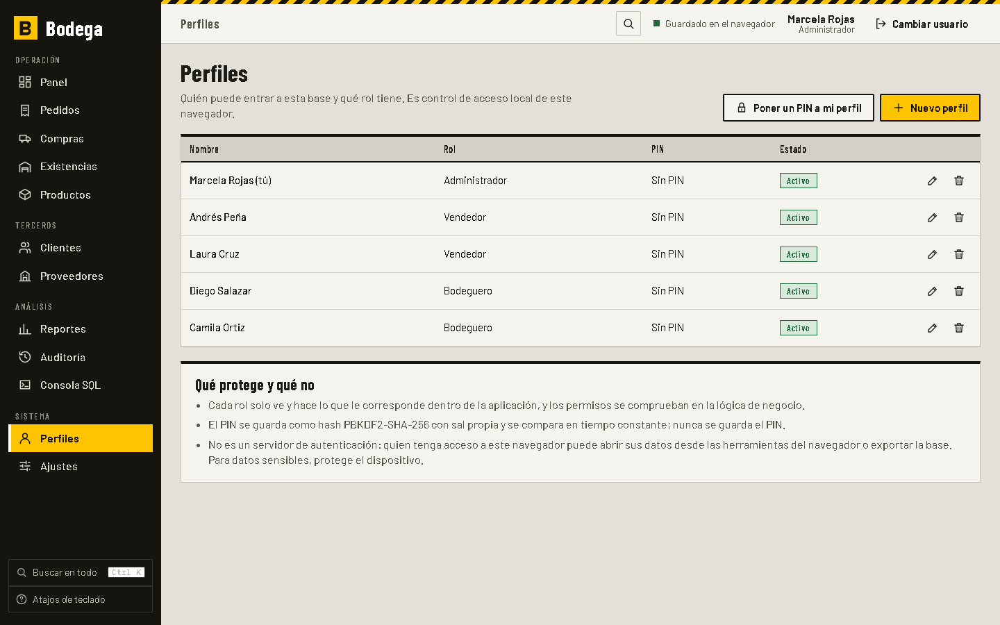

# Bodega

Aplicación web instalable para gestionar inventario, compras y pedidos de una distribuidora pequeña. Su centro es una base **SQLite real** (compilada a WebAssembly con sql.js) que corre en tu navegador, con esquema normalizado, claves foráneas, restricciones, triggers, vistas e índices. Funciona sin conexión, no necesita servidor ni cuentas y todos los datos quedan en tu navegador.

- Aplicación: <https://juanxd2201.github.io/portfolio/labs/bodega/>
- Licencia MIT · © 2026 Juan Esteban Olaya Muñoz


## Primeros pasos

Al abrir la aplicación por primera vez eliges cómo empezar:

- **Empezar con una base vacía**: creas tu perfil de administrador (con PIN opcional) y el nombre de tu negocio. La base trae los tres roles, una bodega principal y categorías básicas; el resto lo registras tú.
- **Cargar datos de ejemplo**: 64 productos, 150 pedidos, órdenes de compra, clientes, proveedores y cinco perfiles de distintos roles para explorar la aplicación. Se pueden borrar desde «Ajustes».

La decisión queda guardada con la base: la bienvenida no vuelve a aparecer hasta que borres todos los datos.



## Instalarla como aplicación

Bodega es una aplicación web progresiva (PWA):

- **Chrome o Edge**: botón «Instalar aplicación» en la barra lateral o en «Ajustes», o el icono de instalación de la barra de direcciones.
- **Safari (iPhone y iPad)**: Compartir → «Añadir a pantalla de inicio».
- Tras la primera carga **todo queda en caché**, incluidos el motor SQLite (`sql-wasm.wasm`) y las fuentes: abre y funciona sin internet, también para guardar cambios.
- Cuando hay una versión nueva aparece **«Hay una versión nueva»** con un botón **Recargar**.

## Qué se puede hacer

| Módulo | Contenido |
|---|---|
| Panel | Valor del inventario, ventas de 30 días con su variación, stock bajo, pedidos y compras en curso; todo calculado con SQL |
| Productos | CRUD, búsqueda, filtros y orden, rótulo de estantería imprimible, importar y exportar CSV (todo o nada) |
| Existencias | Matriz producto × bodega, ajustes con motivo y traslados entre bodegas |
| Pedidos de venta | Borrador con líneas, aviso de stock por bodega, confirmar, despachar y anular; estados validados por trigger; **impresión del pedido (PDF)** |
| Compras | Órdenes a proveedor, envío y recepción parcial o total; **impresión de la orden de compra (PDF)** |
| Clientes y proveedores | CRUD con baja lógica cuando hay historial |
| Reportes | Stock bajo, rotación, ventas por período, por producto y por cliente, valor del inventario; gráficos SVG propios y exportación CSV |
| Auditoría | Libro de movimientos inmutable, con filtros y paginación |
| Consola SQL | Consultas de solo lectura, explorador del esquema y descarga de `schema.sqlite.sql`, `schema.mysql.sql` y `schema.mssql.sql` |
| Perfiles | Crear, editar, desactivar y eliminar perfiles de acceso con rol y PIN opcional |
| Ajustes | Nombre del negocio, categorías y bodegas propias, copia de seguridad `.sqlite` (exportar e importar), versión, instalación y borrado total de datos |
| Búsqueda global | `Ctrl` + `K`: productos, pedidos, órdenes, clientes y proveedores según el rol |

### Imprimir pedidos y órdenes de compra

En el detalle de un pedido o de una orden, **Imprimir / PDF** abre el cuadro de impresión del navegador con una hoja propia (nombre del negocio, datos del documento, líneas, total y espacios de firma). Desde ahí se imprime o se elige «Guardar como PDF». Una hoja de estilos de impresión oculta el resto de la aplicación.



### Perfiles de acceso y PIN: qué protege y qué no

El acceso es **control local del navegador, sin servidor**:

| Protege | No protege |
|---|---|
| Cada rol (administrador, vendedor, bodeguero) solo ve y hace lo que le corresponde; los permisos se comprueban en la lógica de negocio, no solo en el menú | Los datos del navegador no están cifrados: quien tenga acceso a tu navegador puede leer la base desde las herramientas del navegador o exportarla |
| El PIN (4 a 8 dígitos, opcional) nunca se guarda: solo su hash PBKDF2-SHA-256 con sal propia por perfil (120 000 iteraciones) | No hay autenticación remota, recuperación de PIN ni auditoría de accesos fallidos |
| La comparación del PIN es en tiempo constante y hay espera creciente tras intentos fallidos | La espera tras PIN incorrectos frena el tanteo desde la interfaz, no a quien manipule los datos directamente |
| Siempre queda al menos un administrador activo; un perfil con historial se desactiva en lugar de borrarse | El archivo `.sqlite` exportado incluye los hashes de PIN (los scripts MySQL y SQL Server no) |

Para datos sensibles, protege el dispositivo y haz copias de seguridad cifradas por tu cuenta.



Atajos: `g` + letra navega, `/` busca en la lista, `n` crea, `Ctrl` + `K` busca en todo, `?` muestra todos.

## Privacidad y alcance

- Todos los datos viven en IndexedDB de tu navegador; no se envía nada a ningún servidor.
- Un usuario a la vez por navegador y sin sincronización entre dispositivos: usa la copia `.sqlite` para moverla.
- Si borras los datos del sitio desde el navegador pierdes la base; exporta una copia de seguridad de vez en cuando.
- Los scripts de MySQL y SQL Server no se ejecutaron contra un motor real; su contenido se verifica con pruebas automáticas.

## Stack

Vite 8 · React 19 · TypeScript estricto · sql.js (SQLite en WASM) · Vitest · `playwright-core` para las pruebas de extremo a extremo. Sin librerías de UI ni de gráficos. PWA propia: manifiesto, iconos generados desde un SVG y un service worker que `pwa-plugin.ts` genera en el build.

## Instalación y scripts

```bash
npm install
npm run dev          # servidor de desarrollo
npm run build        # comprueba tipos y genera dist/ (incluye sw.js)
npm run preview      # sirve dist/ en http://127.0.0.1:4173
npm test             # pruebas de dominio y base de datos (Vitest)
npm run test:e2e     # pruebas de navegador (requiere npm run build y Chrome)
npm run capturas     # regenera docs/screenshots/
npm run iconos       # regenera los iconos PNG de public/icons
npm run sql:generar  # regenera sql/schema.mysql.sql y sql/schema.mssql.sql (requiere vite-node)
```

Las pruebas de extremo a extremo usan el Chrome instalado en `C:/Program Files/Google/Chrome/Application/chrome.exe` y no descargan navegadores.

## Estructura

```
src/
  data/       Db (envoltura de sql.js), migraciones (esquema v1 y perfiles v2), almacén IndexedDB
  domain/     servicios por caso de uso, permisos, perfiles y PIN, búsqueda, organización,
              CSV, reportes, consola, exportación SQL
  seed/       datos maestros y semilla determinista de 120 días (datos de ejemplo)
  sql/        esquemas escritos a mano: SQLite, MySQL y SQL Server
  ui/         estado, componentes, impresión, gráficos y páginas
  test/       pruebas Vitest sobre la base real en memoria
pwa-plugin.ts generador del service worker
e2e/          pruebas y capturas con Playwright
sql/          scripts MySQL y SQL Server generados con los datos de ejemplo
docs/         arquitectura, modelo de datos y capturas
public/       sql-wasm.wasm autoalojado, manifiesto e iconos
```

## Decisiones de diseño

- **Los movimientos mandan.** Las existencias solo cambian al insertar movimientos; los pedidos, recepciones, traslados y ajustes generan los suyos mediante triggers. El libro es inmutable y siempre cuadra con las existencias.
- **Todo o nada.** Confirmar un pedido descuenta cada línea en la bodega indicada; si una línea no tiene stock, la base revierte el pedido completo.
- **Reglas en dos capas.** El dominio valida antes para dar mensajes claros; los triggers y las restricciones son la defensa final.
- **Migraciones versionadas.** `PRAGMA user_version` registra la versión; la migración 2 añadió las columnas de PIN sin tocar los datos existentes.
- **Identidad visual.** Estética de depósito: gris cemento, negro y amarillo de seguridad; titulares condensados, cantidades en monoespaciada y tablas densas. En móvil las tablas se convierten en tarjetas.
- **Accesibilidad.** Navegación completa por teclado, foco visible, foco atrapado en diálogos, roles ARIA, tablas alternativas para los gráficos, contraste AA y `prefers-reduced-motion`.

La arquitectura se explica en [docs/ARQUITECTURA.md](docs/ARQUITECTURA.md) y el modelo de datos, con diagrama entidad-relación, triggers, vistas y diferencias entre dialectos, en [docs/MODELO_DE_DATOS.md](docs/MODELO_DE_DATOS.md).

## Pruebas

**Vitest: 157 pruebas en 5 archivos**, sobre la base SQLite real en memoria (sin DOM):

| Archivo | Pruebas | Cubre |
|---|---|---|
| `esquema.test.ts` | 50 | Restricciones y triggers, rollback de pedidos, recepciones, traslados, ajustes, vistas |
| `dominio.test.ts` | 45 | Matriz de permisos por rol, propiedad de pedidos, reglas de estado, SQL parametrizado, consola de solo lectura |
| `csv.test.ts` | 18 | CSV malformado, neutralización de fórmulas, importación todo o nada |
| `semilla.test.ts` | 19 | Datos de ejemplo reproducibles, integridad, reportes, scripts MySQL y SQL Server |
| `perfiles.test.ts` | 25 | PIN (formato, hash con sal, vector RFC 7914, comparación en tiempo constante), perfiles y regla del último administrador, base vacía, migración 2, categorías y bodegas, búsqueda global con permisos y comodines |

**Playwright: 40 pruebas de extremo a extremo** con el Chrome instalado sobre `dist/` servido con `vite preview`. Cada prueba parte de un navegador limpio y falla si aparece cualquier error de consola. Incluyen la bienvenida y la base vacía, PIN correcto e incorrecto con bloqueo temporal, creación de perfiles, búsqueda global, impresión (la hoja se ve solo en modo impresión y se genera un PDF real), ajustes, importación y borrado total, y la PWA: manifiesto e iconos, **uso sin conexión con el motor SQL en caché**, aviso de versión nueva e instalación.

Última ejecución: `npx tsc --noEmit` sin errores, 157 de 157 pruebas Vitest y 40 de 40 pruebas e2e.
