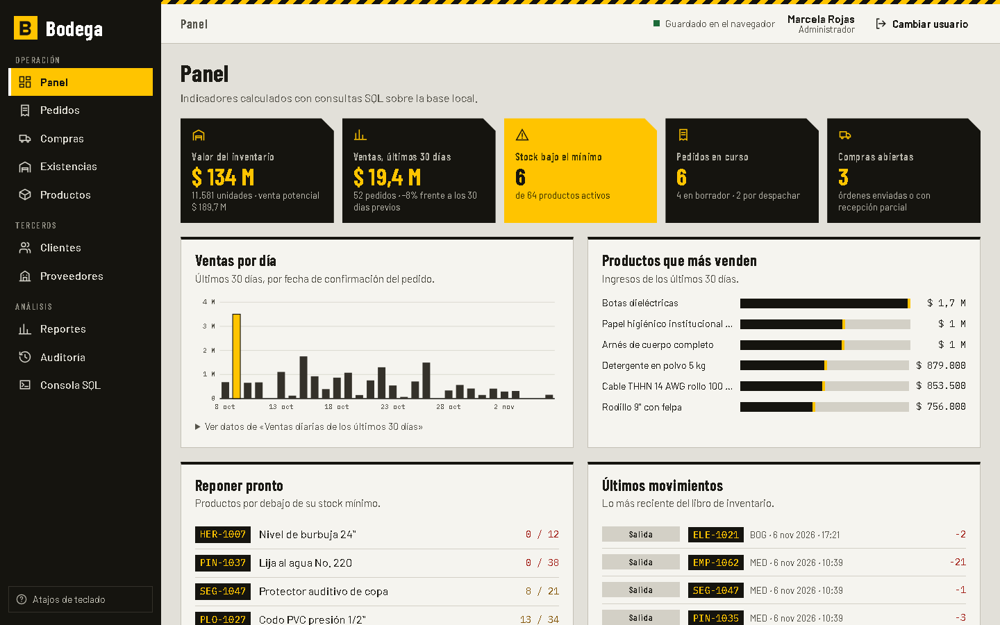

# Bodega

Sistema de gestión de inventario, compras y pedidos para una distribuidora pequeña. Es un proyecto de portafolio de Juan Esteban Olaya cuyo centro es la base de datos: una base **SQLite real** (compilada a WebAssembly con sql.js) que corre en el navegador, con esquema normalizado, claves foráneas, restricciones, triggers, vistas e índices. La interfaz es una aplicación de negocio construida sobre esa base.

- Demo estática prevista: `https://juanxd2201.github.io/portfolio/labs/bodega/`
- Sin servidor, sin cuentas y sin peticiones a terceros: el motor SQL, las fuentes y los datos se sirven desde el propio sitio.



## Qué se puede hacer

| Módulo | Contenido |
|---|---|
| Panel | Valor del inventario, ventas de 30 días con su variación, stock bajo, pedidos y compras en curso; todo calculado con SQL |
| Productos | CRUD, búsqueda, filtros y orden, rótulo de estantería imprimible, importar y exportar CSV (todo o nada) |
| Existencias | Matriz producto × bodega, ajustes con motivo y traslados entre bodegas |
| Pedidos de venta | Borrador con líneas, aviso de stock por bodega, confirmar, despachar y anular; estados validados por trigger |
| Compras | Órdenes a proveedor, envío y recepción parcial o total |
| Clientes y proveedores | CRUD con baja lógica cuando hay historial |
| Reportes | Stock bajo, rotación, ventas por período (día, semana o mes), por producto y por cliente, valor del inventario; gráficos SVG propios y exportación CSV |
| Auditoría | Libro de movimientos inmutable, con filtros y paginación |
| Consola SQL | Consultas de solo lectura, explorador del esquema (tablas, vistas, triggers, índices) y descarga de `schema.sqlite.sql`, `schema.mysql.sql` y `schema.mssql.sql` |

Roles (selector de usuarios de demostración, sin contraseñas):

| Rol | Puede |
|---|---|
| Administrador | Todo, incluida la administración de la base (exportar, importar, restablecer) |
| Vendedor | Crear, confirmar y anular **sus** pedidos, gestionar clientes, consultar catálogo, existencias y reportes |
| Bodeguero | Despachar pedidos, ajustar y trasladar existencias, recibir compras, ver auditoría |

Los permisos se aplican en la capa de dominio, no solo en la interfaz: un vendedor que fuerce una operación recibe un error de permiso. Atajos: `g` + letra para navegar, `/` para buscar, `n` para crear, `?` para ver todos.

## Stack

Vite 8 · React 19 · TypeScript estricto · sql.js (SQLite en WASM) · Vitest · `playwright-core` para las pruebas de extremo a extremo. Sin librerías de UI ni de gráficos.

## Instalación y scripts

```bash
npm install
npm run dev          # servidor de desarrollo
npm run build        # comprueba tipos y genera dist/
npm run preview      # sirve dist/ en http://127.0.0.1:4173
npm test             # pruebas de dominio y base de datos (Vitest)
npm run test:e2e     # pruebas de navegador (requiere npm run build y Chrome)
npm run capturas     # regenera docs/screenshots/
npm run sql:generar  # regenera sql/schema.mysql.sql y sql/schema.mssql.sql
```

Las pruebas de extremo a extremo usan el Chrome instalado en `C:/Program Files/Google/Chrome/Application/chrome.exe` y no descargan navegadores.

## Estructura

```
src/
  data/       Db (envoltura de sql.js), migraciones, almacén IndexedDB
  domain/     servicios por caso de uso, permisos, CSV, reportes, consola, exportación SQL
  seed/       datos maestros y semilla determinista de 120 días
  sql/        esquemas escritos a mano: SQLite, MySQL y SQL Server
  ui/         estado, componentes, gráficos y páginas
  test/       pruebas Vitest sobre la base real en memoria
e2e/          pruebas y capturas con Playwright
sql/          scripts MySQL y SQL Server generados con los datos de ejemplo
docs/         arquitectura, modelo de datos y capturas
public/       sql-wasm.wasm autoalojado
```

## Decisiones de diseño

- **Los movimientos mandan.** Las existencias solo cambian al insertar movimientos; los pedidos, recepciones, traslados y ajustes generan los suyos mediante triggers. El libro es inmutable y siempre cuadra con las existencias.
- **Todo o nada.** Confirmar un pedido descuenta cada línea en la bodega indicada; si una línea no tiene stock, la base revierte el pedido completo.
- **Reglas en dos capas.** El dominio valida antes para dar mensajes claros; los triggers y las restricciones son la defensa final.
- **Datos reproducibles.** La semilla pasa por los mismos servicios que usa la interfaz, con un generador con semilla fija y fechas relativas a hoy.
- **Identidad visual.** Estética de depósito: gris cemento, negro y amarillo de seguridad; titulares condensados, códigos y cantidades en monoespaciada, rótulos de estantería con código de barras decorativo y tablas densas. En móvil las tablas se convierten en tarjetas y la navegación pasa abajo.
- **Accesibilidad.** Navegación completa por teclado, foco visible, foco atrapado en diálogos, roles ARIA, tablas alternativas para los gráficos, contraste AA y respeto de `prefers-reduced-motion`.

La arquitectura se explica en [docs/ARQUITECTURA.md](docs/ARQUITECTURA.md) y el modelo, con diagrama entidad-relación, triggers, vistas y diferencias entre dialectos, en [docs/MODELO_DE_DATOS.md](docs/MODELO_DE_DATOS.md).

## Pruebas

**Vitest: 132 pruebas en 4 archivos**, sobre la base SQLite real en memoria (sin DOM):

| Archivo | Pruebas | Cubre |
|---|---|---|
|  | 50 | Cada restricción y trigger, rollback de un pedido con una línea sin stock, recepción parcial y total, traslados atómicos, ajustes, estados válidos e inválidos, vistas contra cifras calculadas a mano |
|  | 45 | Matriz de permisos por rol, propiedad de pedidos, reglas de estado, mensajes de validación, SQL parametrizado con comillas y comodines, consola de solo lectura |
|  | 18 | CSV malformado (comilla sin cerrar, filas de distinto ancho), neutralización de fórmulas, importación todo o nada |
|  | 19 | Volumen y reproducibilidad de la semilla, integridad (existencias = suma de movimientos), reportes con cifras verificadas a mano, scripts MySQL y SQL Server |

**Playwright: 26 pruebas de extremo a extremo** con el Chrome instalado, sirviendo  con . Cada prueba parte de un navegador limpio, recorre flujos reales por rol (crear y confirmar pedidos, despachar, trasladar, recibir compras, importar CSV, consola SQL, restablecer, persistencia tras recargar, teclado, móvil) y **falla si aparece cualquier error de consola**.

Resultado de la última ejecución: error TS5023: Unknown compiler option '--noEmit'. sin errores, 132 de 132 pruebas Vitest, 26 de 26 pruebas e2e,  de 1,5 MB (incluye el motor WASM de 0,67 MB y las fuentes).

## Demo estática

`vite.config.ts` usa `base: './'`, de modo que `dist/` funciona en cualquier subruta (por ejemplo `/portfolio/labs/bodega/`) y la navegación por hash no necesita reglas de servidor. Los datos se guardan en IndexedDB del navegador: cada visitante tiene su propia copia y puede restablecerla desde la Consola SQL.

## Limitaciones

- Un usuario a la vez y sin sincronización entre pestañas.
- Los scripts de MySQL y SQL Server no se ejecutaron contra un motor real; se verifica su contenido con pruebas automáticas.
- Los usuarios son de demostración: no hay autenticación.
