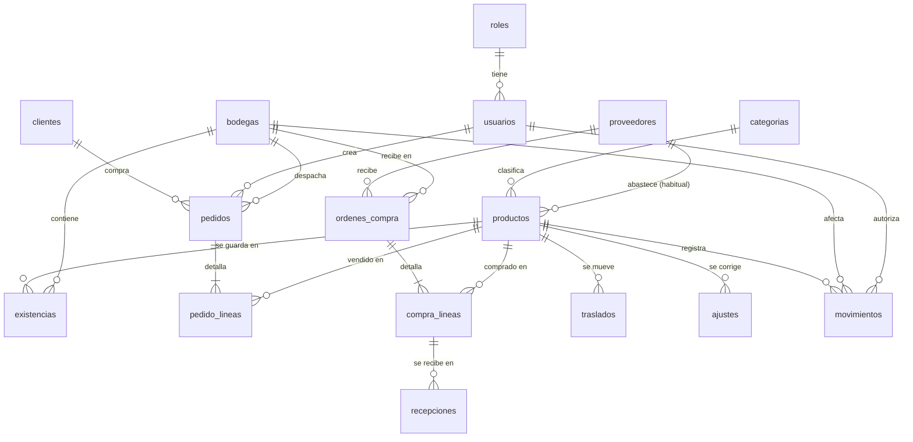

# Modelo de datos

Bodega usa SQLite (compilado a WebAssembly con sql.js). El esquema vive en `src/sql/schema.sqlite.sql`, se aplica mediante migraciones versionadas (`PRAGMA user_version`) y se abre siempre con `PRAGMA foreign_keys = ON`.

Convenciones: nombres en español y minúsculas, dinero en pesos colombianos como entero, fechas como texto `AAAA-MM-DD HH:MM:SS` en hora local.

## Diagrama entidad-relación

## Tablas

| Tabla | Propósito | Restricciones destacadas |
|---|---|---|
| `roles`, `usuarios` | Identidad y rol de demostración | `roles.nombre` limitado a administrador, vendedor y bodeguero; correo único |
| `categorias`, `proveedores`, `bodegas`, `clientes` | Datos maestros | Nombre, NIT, código y documento únicos; `activo` solo 0 o 1 |
| `productos` | Catálogo | `sku` único, en mayúsculas, solo letras, números y guiones; `costo >= 0`; `precio > 0`; `stock_minimo >= 0` |
| `existencias` | Cantidad por producto y bodega | Clave primaria compuesta; `cantidad >= 0` |
| `pedidos`, `pedido_lineas` | Venta | Estado restringido; `cantidad > 0`; un producto una sola vez por pedido; las líneas se borran con el pedido |
| `ordenes_compra`, `compra_lineas` | Compra | `cantidad_recibida <= cantidad_pedida` |
| `recepciones` | Cada ingreso (parcial o total) de una línea de compra | `cantidad > 0` |
| `traslados`, `ajustes` | Operaciones de inventario | origen distinto de destino; ajuste distinto de cero y con motivo válido |
| `movimientos` | Libro de inventario | Tipo y signo coherentes; inmutable por trigger |

Las claves foráneas impiden borrar lo que tiene historial: un producto con movimientos no se elimina, se desactiva desde la aplicación.

## Cómo cambian las existencias

`movimientos` es la única vía. Ninguna parte de la aplicación hace `UPDATE existencias`: los documentos (pedido, recepción, traslado, ajuste) insertan movimientos y un trigger los aplica. Así el libro y las existencias siempre cuadran, y una prueba lo comprueba sobre toda la semilla.

## Triggers

| Trigger | Momento | Qué hace |
|---|---|---|
| `trg_productos_precio_ins` / `_upd` | antes de insertar o actualizar productos | Rechaza `precio < costo` |
| `trg_mov_stock_suficiente` | antes de insertar movimiento | Rechaza una salida que dejaría la existencia en negativo |
| `trg_mov_aplicar` | después de insertar movimiento | Crea la fila de existencias si falta y suma el movimiento |
| `trg_mov_inmutable_upd` / `_del` | antes de modificar o borrar | Los movimientos no se pueden cambiar |
| `trg_pedidos_transicion` | antes de cambiar el estado | Solo borrador→confirmado/anulado y confirmado→despachado/anulado |
| `trg_pedidos_sin_lineas` | antes de confirmar | Exige al menos una línea |
| `trg_pedidos_confirmar` | después de confirmar | Una salida por línea en la bodega del pedido; si una falla, el pedido completo vuelve atrás |
| `trg_pedidos_anular` | después de anular un confirmado | Devuelve el stock con movimientos de entrada |
| `trg_pedidos_borrar` | antes de borrar | Solo borradores |
| `trg_lineas_pedido_*` | antes de insertar, cambiar o borrar líneas | Solo con el pedido en borrador |
| `trg_ordenes_transicion`, `trg_ordenes_sin_lineas`, `trg_ordenes_borrar` | órdenes de compra | Mismo patrón de estados que los pedidos |
| `trg_compra_lineas_*` | líneas de compra | Solo se editan en borrador (la cantidad recibida sí cambia al recibir) |
| `trg_recepciones_validar`, `trg_recepciones_pendiente` | antes de recibir | La orden debe estar enviada o parcial y no se puede recibir más de lo pendiente |
| `trg_recepciones_aplicar` | después de recibir | Suma a la línea, registra la entrada y pasa la orden a parcial o recibida |
| `trg_traslados_aplicar` | después de un traslado | Una salida en el origen y una entrada en el destino |
| `trg_ajustes_aplicar` | después de un ajuste | Un movimiento de ajuste con su motivo |

Todo se ejecuta dentro de una transacción (`Db.transaccion`, con puntos de guardado para anidarlas). Si cualquier paso falla, no queda nada a medias: por ejemplo, un pedido con cinco líneas donde la cuarta no tiene stock no descuenta ninguna.

## Vistas

| Vista | Resultado |
|---|---|
| `v_stock_producto` | Stock total por producto |
| `v_stock_bajo` | Productos activos por debajo de su mínimo, con faltante |
| `v_valor_inventario` | Valor a costo y a precio de venta por producto y bodega |
| `v_pedidos_totales`, `v_ordenes_totales` | Líneas, unidades y total por documento |
| `v_ventas_producto`, `v_ventas_cliente` | Ventas efectivas (pedidos confirmados o despachados), ingresos y margen |
| `v_rotacion` | Unidades vendidas netas (descontando anulaciones) frente al stock actual |
| `v_movimientos_detalle` | Libro de movimientos con producto, bodega y usuario |

Las pruebas verifican las vistas contra cifras calculadas a mano en un escenario pequeño.

## Índices

Por clave foránea (`categoria_id`, `cliente_id`, `proveedor_id`, `producto_id` en líneas, `bodega_id` en existencias) y para las consultas frecuentes: `pedidos(estado, fecha)`, `movimientos(producto_id, fecha)`, `movimientos(fecha)`, `movimientos(referencia_tipo, referencia_id)`.

## Scripts MySQL y SQL Server

Los archivos `sql/schema.mysql.sql` y `sql/schema.mssql.sql` (también descargables desde la Consola SQL) están escritos a mano a partir del esquema SQLite e incluyen los datos de la semilla. Se generan con `npm run sql:generar`, que reemplaza la marca `-- @@DATOS@@` por los `INSERT`. Los triggers se crean después de cargar los datos para no duplicar movimientos.

| Aspecto | SQLite | MySQL 8.0.16+ | SQL Server 2019+ |
|---|---|---|---|
| Identidad | `INTEGER PRIMARY KEY AUTOINCREMENT` | `INT AUTO_INCREMENT` | `INT IDENTITY(1,1)` y `SET IDENTITY_INSERT` al cargar |
| Texto y fechas | `TEXT` | `VARCHAR`, `DATETIME` | `NVARCHAR`, `DATETIME2` |
| Booleanos | `INTEGER` con CHECK 0/1 | `TINYINT(1)` | `BIT` |
| Formato del SKU | `NOT GLOB '*[^A-Z0-9-]*'` | `REGEXP '^[A-Z0-9-]+$'` | `LIKE` con intercalación binaria |
| Errores en triggers | `RAISE(ABORT, ...)` | `SIGNAL SQLSTATE '45000'` | `THROW` |
| Triggers antes de la operación | `BEFORE` | `BEFORE` | No existen: se usa `AFTER` con `THROW`, que revierte la sentencia |
| Disparo | por fila, `WHEN` | por fila, `IF` | por conjunto (`inserted`, `deleted`) |
| «Actualizar solo si cambia la columna» | `UPDATE OF col` | comparar `OLD` y `NEW` | `UPDATE(col)` |
| Upsert de existencias | `INSERT OR IGNORE` + `UPDATE` | `INSERT IGNORE` + `UPDATE` | `INSERT ... WHERE NOT EXISTS` + `UPDATE` |
| Separador de lotes | `;` | `DELIMITER $$` | `GO` |
| Concatenar | `\|\|` | `CONCAT()` | `+` |
| Sumas de dinero en vistas | entero | entero | `CAST(... AS BIGINT)` para evitar desbordes |

**Verificación.** Los scripts de MySQL y SQL Server no se ejecutaron contra un motor real en el entorno de desarrollo (solo hay SQLite). Su contenido sí se comprueba con pruebas automáticas: contienen todas las tablas, vistas y triggers, el orden de carga es correcto y el volcado tiene una fila por registro de la base. Antes de usarlos en un servidor conviene correrlos en una instancia de prueba.
